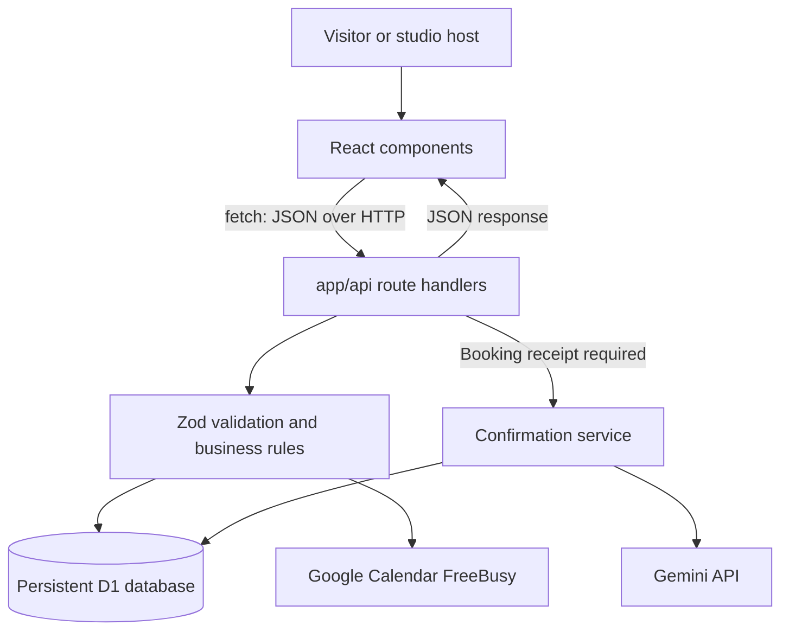

# Sunroom: a quick guide to the code

Sunroom has one tanning bed and two views: visitors book sessions, and the studio publishes availability. The browser draws the interface; the server validates requests and decides whether a booking can be saved. The database keeps that decision after a refresh or restart.

## 1. Start with the technologies

| Technology | What it does here | How it works |
| --- | --- | --- |
| React 19 | Builds the booking and studio screens | Components describe the screen from state. A click updates state, and React updates the affected interface. |
| TypeScript | Checks the shape of data while developing | Types catch mistakes such as passing a string where a slot needs a numeric timestamp. They do not validate incoming network requests. |
| Vinext + Vite | Connects page files, API routes, development, and production builds | Vinext implements the Next.js App Router conventions on Vite. Vite serves changes during development and bundles the app for deployment. |
| Cloudflare Workers | Runs the backend | A Worker receives HTTP requests and hands them to Vinext's page or API handler. There is no separate Express or NestJS server. |
| Cloudflare D1 / SQLite | Stores slots and bookings | Tables live outside React and the Worker process. Parameterized SQL reads and changes those tables. |
| Drizzle | Defines the database structure | `db/schema.ts` describes tables and constraints; Drizzle generates SQL migrations. The booking code uses D1's SQL API directly. |
| Zod | Checks data at runtime | Schemas reject invalid booking input and unexpected Google responses before the app uses them. |
| CSS + Lucide | Provides layout, colors, and icons | `app/globals.css` supplies the Sunroom design; Lucide supplies SVG icons. Tailwind is available in the starter, but the main interface uses named CSS classes. |
| Google Calendar API + jose | Checks external busy periods | `jose` signs a service-account JWT. Google exchanges it for an access token, then the server requests free/busy intervals. |
| Gemini API | Generates a short confirmation note | The backend sends a fixed prompt over HTTPS and validates the returned text. The booking never depends on AI success. |

The project retains some unused starter libraries and `components/ui/` components. They are not required to understand the booking flow.

## 2. Follow the application entry points

Read these files in this order:

1. [`app/layout.tsx`](../app/layout.tsx): the shared HTML layout, metadata, and stylesheet import.
2. [`app/page.tsx`](../app/page.tsx): renders the main `Sunroom` component.
3. [`app/sunroom.tsx`](../app/sunroom.tsx): coordinates state, API calls, and dialogs.
4. [`components/booking-calendar.tsx`](../components/booking-calendar.tsx) and [`session-list.tsx`](../components/session-list.tsx): display the same slots in two layouts.
5. [`components/studio-dashboard.tsx`](../components/studio-dashboard.tsx): displays the host's schedule and publishing controls.
6. [`components/session-dialogs.tsx`](../components/session-dialogs.tsx): the booking, confirmation, and publishing forms.

`Sunroom` is a client component (`"use client"`) because it handles browser interactions. `useState` remembers the selected date, duration filter, slot, and open dialog. `useEffect` starts loading and refreshes availability every 20 seconds and when the window regains focus. Components receive values and callbacks through props instead of maintaining separate copies of the schedule.

## 3. Understand the complete request path



The frontend's small `request<T>()` helper uses `fetch`, reads JSON, and turns unsuccessful responses into useful errors. The server's [`lib/api.ts`](../lib/api.ts) supplies the database binding, JSON responses, request validation, and error handling. Responses use `Cache-Control: no-store` so an old cached response does not become the source of availability.

### When the page first opens

1. The browser calls `POST /api/setup`. This creates sample availability once, using the `settings` table to remember that setup already happened. It never resets bookings.
2. It calls `GET /api/slots`.
3. [`listSlots()`](../lib/reservations.ts) reads future slots from D1 and asks the calendar provider for busy intervals when configured.
4. The response includes `booked` and `calendarBlocked`, without guest contact details.
5. React displays the result. [`isAvailable()`](../lib/booking.ts) consistently excludes booked and calendar-blocked slots from selection and counts.

### When the host publishes a slot

1. The publishing form sends date, start time, and duration to `POST /api/slots`.
2. The handler checks the input, interprets it in **UTC**, and rejects times outside the supported future range.
3. A single SQL `INSERT ... SELECT ... WHERE NOT EXISTS` checks for an overlapping slot and inserts only if none exists.
4. The server returns the new slot; React adds it to the displayed schedule.

The interval rule is `existingStart < newEnd && existingEnd > newStart`. A session ending at 10:15 can sit immediately before another starting at 10:15.

### When a visitor books

1. Selecting a time only changes React state; it does not reserve anything.
2. The visitor enters their name and email. The form sends `{ slotId, name, email }` to `POST /api/bookings`.
3. The route validates the request. [`reserveSlot()`](../lib/reservations.ts) reads the slot and makes a fresh Calendar check, because an external event may have appeared since the listing loaded.
4. A conditional SQL update saves the guest only if the row is still unbooked and in the future:

   ```sql
   UPDATE slots
   SET booked_at = ?, guest_name = ?, guest_email = ?, confirmation_token_hash = ?
   WHERE id = ? AND booked_at IS NULL AND starts_at > ?
   RETURNING id, starts_at AS startsAt, duration;
   ```

5. Only one competing request can change the row. The others receive **409 Conflict**. Disabling a button helps the user; this SQL condition provides the actual protection.
6. The response includes the saved slot, a standard confirmation message, and a random receipt token. Only the token's SHA-256 hash is stored in D1.
7. The browser immediately shows success and starts a separate confirmation request for the chat panel beside the session. Other visitors see the slot as booked on their next refresh.

## 4. Follow the optional integrations

### Google Calendar

[`lib/integrations/runtime.ts`](../lib/integrations/runtime.ts) creates the providers from server environment variables. [`calendar.ts`](../lib/integrations/calendar.ts) signs a JWT, gets a Google access token, and calls the FreeBusy API. Only the short-lived access token is cached; busy results are fetched again.

The service account must have free/busy access to the studio calendar. There is no visitor Google sign-in and no event creation. Overlapping events mark slots unavailable. With no Calendar configuration, normal booking works. Partial configuration or a configured provider failure returns **503** rather than guessing that a time is free. Events can still change after the final check; Google and D1 do not share a transaction.

### Gemini confirmations

The browser calls `POST /api/confirmations` with `{ slotId, token }`. [`lib/confirmations.ts`](../lib/confirmations.ts) checks the receipt hash and atomically claims the generation attempt before calling [`gemini.ts`](../lib/integrations/gemini.ts).

Gemini receives a fixed generic prompt, without the guest's name, email, booking time, or calendar details. The model is `gemini-3.5-flash-lite`, with a free tier; its name is shared between configuration status and the HTTP client. A valid result is saved to D1. Repeated requests return the saved note, and simultaneous requests cannot start extra model calls. The frontend keeps the response's `source` so the chat bubble attributes generated notes to Gemini and labels fallbacks as studio notes. Missing credentials, timeouts, quota errors, or invalid output produce a standard friendly message. The reservation remains saved. An interrupted attempt can remain pending with that standard message; the app deliberately avoids automatic repeated model calls.

See [the integration setup guide](integrations.md) for credentials and live checks. Credentials belong in ignored `.dev.vars` locally and secret runtime variables when hosted; they are never sent to the frontend. A **Configured** label reports configuration presence, not proof that the credentials work.

## 5. Know where data and layout live

[`db/schema.ts`](../db/schema.ts) defines `slots` and `settings`. Each slot stores a start timestamp, duration, optional guest details, and confirmation state. A non-null `booked_at` means it is booked. Constraints enforce a valid duration and complete guest details for booked rows.

[`drizzle/`](../drizzle/) contains versioned SQL migrations. Add a new migration when changing the schema; preserve old migrations because hosted databases may already have applied them. `.wrangler/state` stores the local database. The deployed D1 database is separate and survives app deployments.

[`app/globals.css`](../app/globals.css) controls presentation. The page uses fluid side padding instead of a desktop width cap. CSS Grid divides the studio card, calendar, and time choices; `clamp()` lets sizes grow within readable bounds. Media queries stack the panels on narrower screens. Changing this stylesheet does not change booking rules.

The confirmation's **Add to Google Calendar** link is built in [`lib/booking.ts`](../lib/booking.ts). It opens Google's event editor with the session title, UTC start/end times, location, and arrival note. The visitor chooses their calendar and saves the event. Guest contact details and booking receipts are excluded from the URL. A separate **Download calendar file (.ics)** option supports other calendar apps. Neither option automatically writes to the studio's shared calendar or sends an email.

## 6. Run and check it

Follow [the README](../README.md#run-locally) for setup. Useful checks:

| Command | What it proves |
| --- | --- |
| `npm run typecheck` | TypeScript connections between modules are valid. |
| `npm test` | 33 deterministic provider, SQLite, calendar-link, and Worker runtime tests cover concurrency, validation, receipt protection, HTTP compatibility, redirects, UTC date boundaries, and failure behavior. No live API calls. |
| `npm run build` | The frontend and Worker compile into a production deployment. |
| `npm run test:api` | With the local server running, real HTTP requests exercise publishing, booking races, and confirmation caching. It refuses remote targets. |
| `npm run test:live` | Optional real Google/Gemini calls using local credentials. Missing credentials mean skipped tests, not verified integrations. |

[`tests/support/fixtures.mjs`](../tests/support/fixtures.mjs) applies the actual SQL migrations to isolated SQLite databases. Provider tests use controlled fake HTTP responses. [GitHub Actions](../.github/workflows/ci.yml) runs the deterministic checks, build, migrations, and HTTP tests automatically.

[`tests/workers.test.mjs`](../tests/workers.test.mjs) runs the actual HTTP helper inside workerd with intercepted traffic. This catches runtime differences that a Node mock misses: Workers rejects `redirect: "error"`, so the helper uses `manual` and rejects non-success responses, including redirects. The HTTP API test checks availability before writing test records and reports a useful error if the server returns 503.

## 7. Explain deployment and the main tradeoff

[`worker/index.ts`](../worker/index.ts) passes incoming requests to Vinext. [`vite.config.ts`](../vite.config.ts) connects Vinext, Cloudflare, and the Sites build plugin. [`.openai/hosting.json`](../.openai/hosting.json) identifies the hosted project and its `DB` binding. Sites applies migrations and deploys the bundled Worker and frontend assets. GitHub stores the reviewable source; publishing to GitHub and deploying the site are separate operations.

The main simplification is the brief's **no-login** design: anyone can open the studio view and call management endpoints. Before real customer use, add host authorization, rate limits, cancellation/rescheduling, and a guest-data retention policy. Email delivery and Google event creation would be separate features.

An interview explanation could be: “React handles selection and forms, but the server owns availability. The server validates every request, rechecks Google Calendar, and uses a conditional database write so only one booking wins. AI runs after the booking is saved, uses a receipt to prevent arbitrary generation, and falls back safely. Tests cover both concurrent requests and external-provider failures.”
